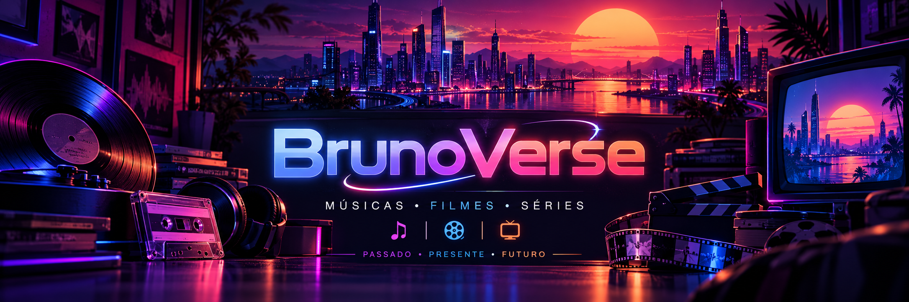

  

<!-- <h1 align="center">BrunoVerse</h1> -->

<strong>Músicas • Filmes • Séries</strong>

Passado • Presente • Futuro

  
  
  
  

## Sobre o projeto

**BrunoVerse** é um site pessoal criado para reunir preferências sobre **músicas, filmes e séries**, organizadas dentro de um conceito visual chamado **Universo Híbrido** — uma mistura de nostalgia, cultura pop e atmosfera futurista inspirada em plataformas de streaming.

O projeto foi pensado para funcionar como um espaço público de apresentação, enquanto futuramente contará com uma **administração privada** para que o proprietário possa atualizar suas coleções com praticidade.

---

## Objetivo

Construir um acervo pessoal e visualmente marcante para registrar:

- obras que marcaram o **passado**;
- favoritos do **presente**;
- descobertas, desejos e lançamentos para o **futuro**.

O BrunoVerse não é apenas um catálogo: ele busca transmitir a sensação de uma **linha do tempo afetiva do entretenimento**.

---

## Capas e pôsteres (integração TMDb + Last.fm)

A atualização de mídia é feita por **GitHub Actions**, não diretamente pelo navegador. Assim, o site hospedado no GitHub Pages permanece estático e as credenciais são mantidas em **GitHub Secrets**.

## Tecnologias utilizadas

- **HTML5**
- **CSS3**
- **JavaScript (Vanilla JS)**
- **GitHub Pages** para publicação estática

---

## Direção visual

O BrunoVerse utiliza uma estética autoral baseada em:

- **neon roxo, azul, rosa e laranja**;
- atmosfera de **streaming premium**;
- referências a **retrô, nostalgia, synthwave e sci-fi**;
- organização moderna com foco em **imersão visual**.

---

## Observações importantes

Este projeto foi criado como um **site pessoal autoral**. O objetivo é apresentar gostos, referências e descobertas do proprietário, com potencial de expansão futura.

As imagens e artes internas desta fase foram produzidas para identidade visual do projeto e não representam ainda a coleção final com capas e pôsteres oficiais.

---

## Autor

**BrunoVerse**

Projeto pessoal para registro e apresentação de preferências sobre música, cinema e séries.

---

## 📄 Licença

Projeto destinado a **uso pessoal e apresentação pública do acervo do autor**.

Caso deseje transformar este projeto em produto, portfólio profissional ou plataforma completa, recomenda-se definir uma licença específica posteriormente.
